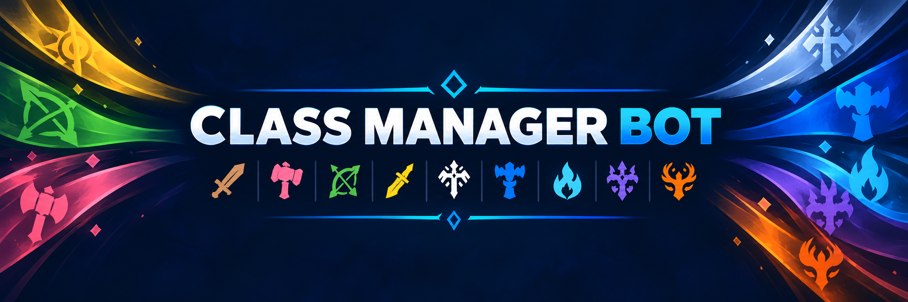

# WoW Discord Class Manager

A small, self-hosted Discord bot that helps a World of Warcraft: Forever community share the characters its members plan to play. Members register a two-part character name, class and gameplay role, keep any number of alts, and choose one main. Plans can change: the bot safely updates each member's Discord class role when they choose a different main.

**Create a Discord application → Configure the token → Start the container → Invite the bot → Run `/class setup` → Done.** Inviting the bot before starting the container works too.

## What members see

One public message titled **World of Warcraft Character Manager**, with **My Characters** and, when enabled, **Community Roster** buttons. Character management and roster browsing open private views; the public panel stays unchanged.

1. Choose **My Characters → Add Character**, select Paladin, and enter **First Name: John** and **Secondary Name: Stormwind** in separate fields. Submit the form, then choose **DPS**, **Healing** or **Tank** to save. **John Stormwind** automatically becomes your first main and receives the Paladin Discord role.
2. Add **Sam Ironforge** as Warrior and choose **DPS** or **Tank**. Sam becomes an alt, John remains main, and your Discord class role stays Paladin.
3. Select **Sam Ironforge** from your character dropdown, then choose **Make Main**. Sam becomes main, John automatically becomes an alt, Warrior replaces Paladin, and both character records remain. Switching back works the same way. Two characters of the same class can exchange main status without removing and reassigning that role.
4. Select a character and use **Edit** to change either name component, class or gameplay role while preserving the record and main/alt status. Submit the details, then choose a supported role to save. Editing an alt's class does not assign an alt role; editing the main's class synchronizes the main Discord role.
5. Select a character and choose **Remove** to see a confirmation. Removing a main with alts first requires choosing a replacement; the old main is removed only after the replacement succeeds. Removing the only character requires `ALLOW_CLEAR_SELECTION=true`.

Your private dashboard refreshes after changes and keeps the character you just added or edited selected. Choosing a character only changes what you are viewing; **Make Main** is a separate action. Paging, Back and Cancel keep navigation in the same private message. Rejected forms keep your entries behind **Edit Details**, so corrections do not require retyping everything.

Each character has one gameplay role, shown in personal and community rosters. The role dropdown offers only roles supported by the selected class; choosing one saves the character. Closing or going back before choosing a role discards the draft. Existing characters show **Role not set** after upgrading; use **Edit** to choose one. Gameplay roles are roster details; the main's class still controls the Discord class color.

| Classes | Available gameplay roles |
| --- | --- |
| Hunter, Mage, Rogue, Warlock | DPS |
| Priest, Shaman, Evoker | DPS, Healing |
| Warrior, Death Knight, Demon Hunter | DPS, Tank |
| Paladin, Druid, Monk | DPS, Healing, Tank |

These are the standard [Blizzard class roles](https://worldofwarcraft.blizzard.com/en-us/game/classes); seasonal alternate roles are not included. Modern classes appear only when enabled by the operator.

Choose **Done** to close your menu. Menus also close after five minutes without interaction; opening another menu in the same channel removes your previous one. Discord does not tell bots when you switch text channels, so closing is based on Done or inactivity. Cleanup is best effort while the bot is running; menus from before a restart may still need Discord's Dismiss message action. You can enter names you plan to use and edit them later; both name fields are still required, and the bot never invents names or claims they are reserved in the game.

WoW Forever uses two name components, with full-name uniqueness within a game region. The bot uses the complete name for local roster comparisons but cannot verify game ownership, availability or naming-policy approval. Its default 2–12 characters per component are configurable application limits. [Blizzard's naming overview](https://news.blizzard.com/en-us/article/24304161/create-a-name-of-your-own-in-wow-forever)

`/character list` privately shows your main and alts. **Community Roster** or `/roster` lets you browse what other members plan to play using class, main/alt and member dropdown filters, with paging and Reset Filters. Access follows the operator's roster visibility setting. Long rosters use pages; the default character limit is unlimited. Different Discord users may self-report the same full name, while duplicates within one member's guild roster are rejected.

Discord displays the color of a member's highest colored role. An officer role above a class role can override the visible class color.

## Features

- The nine original Classic classes enabled by default; four modern classes available by configuration.
- Two-part Unicode character names, one main per guild member, automatic main/alt switching and private dashboards.
- Per-character DPS, Healing or Tank selection with class restrictions.
- A community roster with native filters and pagination to discover members' current character plans.
- Automatic role discovery and creation on startup and server join, with safe, repeatable synchronization.
- Persistent panels, character records and SQLite role associations that survive container restarts.
- Configurable role names, colors, panel text, command names and guild allowlist.
- No inbound ports, web server, public interaction endpoint or privileged Gateway intents.
- Non-root Docker/Podman container, token-file support, local health check and optional administrative alerts.
- Locked dependencies, mocked Discord tests, CI and AMD64/ARM64 publishing workflow.

## Prerequisites

You need a Discord account allowed to install apps in your server, a Discord application belonging to you, and a computer or Linux server running Docker Engine with the Compose plugin (or Docker Desktop in Linux-container mode). The bot needs outbound HTTPS/WebSocket access to Discord. No port forwarding is needed.

## Quick start

1. Open the [Discord Developer Portal](https://discord.com/developers/applications), choose **New Application**, then open **Bot → Reset Token**. Keep the token private. Leave all privileged intents off and the **Interactions Endpoint URL unset**.
2. Download the project and configure your token:

   ```sh
   git clone https://github.com/landmine-1252/wow-discord-class-manager.git
   cd wow-discord-class-manager
   cp .env.example .env
   chmod 600 .env
   ```

   Edit `.env` and replace `DISCORD_BOT_TOKEN` with your token. Everything else has a default.
3. Build and start locally; this works before the first public image is released:

   ```sh
   docker compose -f compose.yaml -f compose.build.yaml up -d --build
   docker compose logs --tail=50 -f bot
   ```

   Once the GHCR release exists, use `BOT_IMAGE=ghcr.io/landmine-1252/wow-discord-class-manager:1.1.0` in `.env`, then run:

   ```sh
   docker compose pull
   docker compose up -d
   ```

4. In the Developer Portal, open **Installation**, enable **Guild Install**, and select **Discord Provided Link**. Under Guild Install defaults choose scopes **bot** and **applications.commands**. Give the bot **Manage Roles**, **View Channels**, **Send Messages**, **Embed Links**, and **Read Message History**. Copy the installation link and invite it. Do not grant Administrator.
5. In your server's role settings, put the bot's role above existing class roles. In a text channel, run **`/class setup`** as someone with **Manage Server and Manage Roles**. The bot creates or safely reuses the class roles and publishes one panel.

Members use the public buttons or `/character add`, `/character list`, `/character main`, `/character edit`, `/character remove` and `/character help`. Officers retain `/class setup`, `/class sync` and `/class status`. Run setup again to update the existing bot-owned panel; explicitly choose a different `channel` option to move it. An officer with Manage Server and Manage Roles can use `/character purge` to remove a member's stored roster after confirmation.

Existing class-only users keep their roles and can register at their convenience. No character names are invented during upgrade. Once a member has a registered roster, it controls their class: `/class set` and `/class clear` guide them to character management. Set `ENABLE_CHARACTER_MANAGEMENT=false` to restore the original class-selection panel and behavior while retaining stored characters for later use.

## Configuration and operations

The only required credential is **one** of `DISCORD_BOT_TOKEN` or `DISCORD_BOT_TOKEN_FILE`. Do not configure both. An application ID and public key are unnecessary for normal operation. All settings live in the environment; Compose loads `.env`.

- [Discord application and server setup](docs/discord-setup.md)
- [Every environment variable and configuration examples](docs/configuration.md)
- [Deployment, updates, Docker secrets, Podman and backups](docs/deployment.md)
- [Troubleshooting](docs/troubleshooting.md)
- [Architecture and persistence](docs/architecture.md)
- [Release and GHCR publishing procedure](docs/releasing.md)

After editing `.env`, run `docker compose up -d --force-recreate` (include the build override when using a local build). A plain restart does not reload the container environment. Existing panels refresh on startup. Back up the database before upgrades, then pull the chosen version and recreate the container. Never use `down -v` unless you intend to delete the stored associations.

## Safety and limitations

Class roles must be cosmetic: **no role permissions and no channel permission grants**. The bot refuses unsafe, integration-owned, ambiguous or unmanageable roles. It never deletes roles or reorders server roles. Disabling a class alone preserves its characters and role assignments. An explicit switch to an enabled registered main removes obsolete managed class assignments, including an old disabled-class assignment, so only the main determines the class color. Legacy class-only selection retains its original enabled-only cleanup policy.

Run exactly one process per application/database. Keep `.env`, token files and backups private. The database now stores Discord owner IDs, self-reported character names/classes/gameplay roles, main associations and recovery operations alongside server/role/panel IDs. No Battle.net credentials or message contents are collected. Leaving a guild does not delete a roster. See [SECURITY.md](SECURITY.md) for privacy, deletion, token rotation and private vulnerability reporting.

Before upgrading from the class-only release, stop the bot and back up its `/data` volume. Schema migrations preserve existing roles and panel IDs; the saved panel is updated in place. A rollback to an older image may require restoring the pre-upgrade database. See [deployment](docs/deployment.md#upgrading-an-existing-class-only-installation).

Race and faction metadata are not collected in this version. Names never imply race or faction; the model can add optional metadata in a later additive migration.

Automated tests use simulated Discord APIs. Before a public release, perform the [live acceptance checklist](docs/releasing.md#live-discord-acceptance-test) with your own application and a test server. Publishing workflows are provided; image availability depends on the repository owner running them and making the GHCR package Public.

## Project artwork

Use the [square icon](docs/assets/branding/cmb-icon.png) and [wide banner](docs/assets/branding/cmb-banner.png) for your installation or community documentation. Both are included as original PNGs. The [Discord setup guide](docs/discord-setup.md#optional-project-artwork) includes an icon preview and application branding instructions.

## Contributing and license

See [CONTRIBUTING.md](CONTRIBUTING.md) for local development and checks. Contributions that keep class selection simple and safe are welcome. Licensed under the [MIT License](LICENSE). World of Warcraft and Discord are trademarks of their respective owners; this project is not affiliated with either company.
